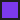
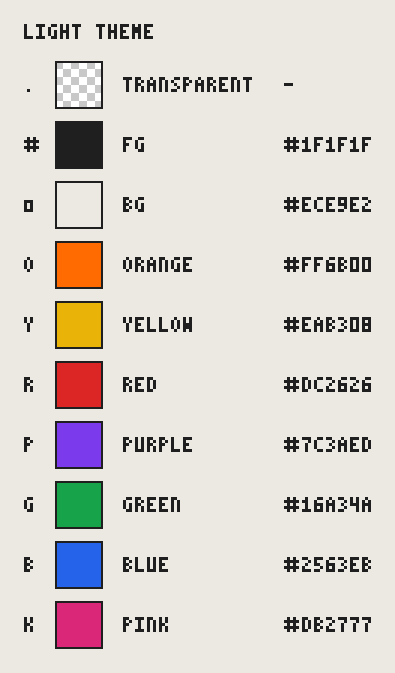
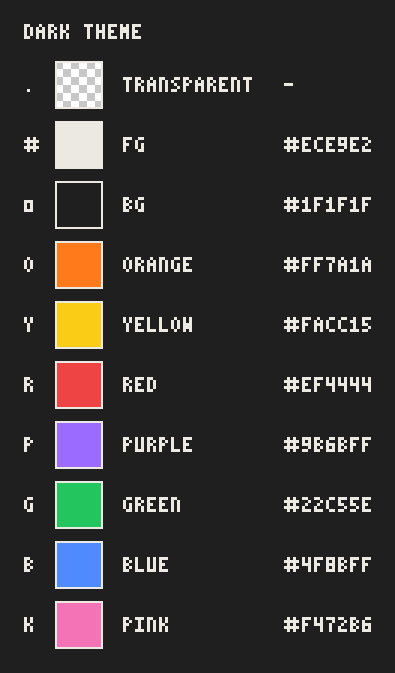
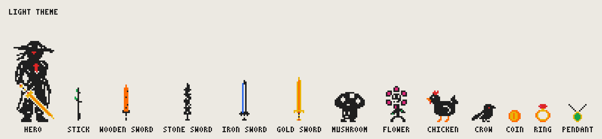
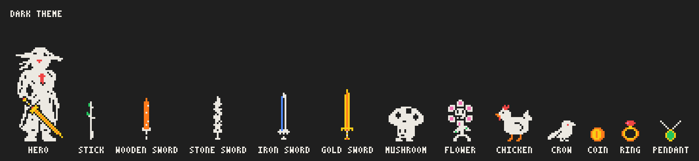

# Colours

Every colour the game draws with, in both themes, with pictures. The table
and the images are generated from the code, so they can't drift: see
[Regenerate](#regenerate).

## How colours work

The game never stores real colours in its art. Sprites are grids of
**slot letters** (see [SPRITES.md](SPRITES.md)), and the renderer looks each
letter up in the current **palette**:

- `src/theme.ts`: `COLOR_NAMES` (the accent names) and `DEFAULT_PALETTES`,
  one palette per theme (`light`, `dark`). Each palette has `bg`, `fg` and one
  value per accent name.
- `src/render/sprites.ts`: the slot map. `.` is transparent, `#` → `fg`,
  `o` → `bg`, and one capital letter per accent.
- The theme follows the host page (`theme` attribute, `<html class="dark">`
  or `prefers-color-scheme`).

In dark mode `fg` and `bg` swap, so `#` (ink) turns light and `o`
(cut-outs) turns dark. The accents keep their slot but use a slightly
brighter shade in dark mode so they read on the dark background.

### Host overrides (`--afk-*`)

A host page can replace any palette value with a CSS custom property named
after the palette key, e.g.:

```css
afk-game {
  --afk-bg: #101418;
  --afk-fg: #f5f5f5;
  --afk-orange: #ff9900;
}
```

`buildPalette` reads `--afk-bg`, `--afk-fg` and `--afk-<accent>` for every
accent name; anything not set falls back to the theme default. The game
then copies the final palette into `--_<key>` variables on its box, which is
what all the UI CSS uses. The images below show the defaults only.

## Palette

<!-- colors-doc:start -->

_Generated by `npm run colors-doc` from `src/theme.ts`, `src/render/sprites.ts` and the 60 sprites exported by `src/sprites/index.ts`. Don't edit by hand._

| Slot | Name | Light | Dark | Used for | Sprites |
| ---- | ---- | ----- | ---- | -------- | ------- |
| `.` | transparent | - | - | Background around the sprite. | 60 |
| `#` | fg |  `#1f1f1f` |  `#ece9e2` | Ink: bodies, coats, outlines. UI text, borders, HP bar frame, damage numbers on the mob. | 55 |
| `o` | bg |  `#ece9e2` |  `#1f1f1f` | Cut-outs inside a silhouette (eyes, hand, folds), outlines that separate ink from ink. Canvas and UI background. | 38 |
| `O` | orange |  `#ff6b00` |  `#ff7a1a` | Accents. Coin pick-up numbers (`+12`). | 17 |
| `Y` | yellow |  `#eab308` |  `#facc15` | Gold, buttons, buckles. Prices in the shop, S-tier item frame and sparkle. | 12 |
| `R` | red |  `#dc2626` |  `#ef4444` | Eyes, scarf, blood. Hit flash (whole sprite), damage taken by the hero, low HP bar, error text. | 20 |
| `P` | purple |  `#7c3aed` |  `#9b6bff` | Accents. Stage label (canvas and HUD) on boss stages. | 2 |
| `G` | green |  `#16a34a` |  `#22c55e` | Leaves, stems. HP bar, B-tier item frame, "on" tags, debug OK text. | 8 |
| `B` | blue |  `#2563eb` |  `#4f8bff` | Accents. Crow damage numbers, A-tier item frame. | 9 |
| `K` | pink |  `#db2777` |  `#f472b6` | Accents. | 2 |

### Which sprites use each slot

- **`#` fg** (55): `boss-mushroom-walk`, `crow-fly-back`, `crow-fly-out`, `crow-idle`, `crow-peck`, `effect-peck-spark`, `effect-slash-arc-gold-sword`, `effect-slash-arc-iron-sword`, `effect-slash-arc-stick`, `effect-slash-arc-stone-sword`, `effect-slash-arc-wooden-sword`, `hero-death`, `hero-hurt`, `hero-idle`, `hero-slash`, `icon-auto-advance`, `icon-crow`, `icon-damage`, `icon-music`, `icon-music-off`, `icon-sfx`, `icon-sfx-off`, `icon-speed`, `icon-weapon`, `item-frame-c`, `item-pendant`, `item-slot-empty`, `mob-chicken-walk`, `mob-flower-walk`, `mob-mushroom-walk`, `weapon-gold-sword-back`, `weapon-gold-sword-downFwd`, `weapon-gold-sword-fwd`, `weapon-gold-sword-up`, `weapon-gold-sword-upFwd`, `weapon-iron-sword-back`, `weapon-iron-sword-downFwd`, `weapon-iron-sword-fwd`, `weapon-iron-sword-up`, `weapon-iron-sword-upFwd`, `weapon-stick-back`, `weapon-stick-downFwd`, `weapon-stick-fwd`, `weapon-stick-up`, `weapon-stick-upFwd`, `weapon-stone-sword-back`, `weapon-stone-sword-downFwd`, `weapon-stone-sword-fwd`, `weapon-stone-sword-up`, `weapon-stone-sword-upFwd`, `weapon-wooden-sword-back`, `weapon-wooden-sword-downFwd`, `weapon-wooden-sword-fwd`, `weapon-wooden-sword-up`, `weapon-wooden-sword-upFwd`
- **`o` bg** (38): `boss-mushroom-walk`, `crow-idle`, `effect-slash-arc-stone-sword`, `hero-death`, `hero-hurt`, `hero-idle`, `hero-slash`, `icon-crow`, `icon-music-off`, `icon-sfx-off`, `mob-chicken-walk`, `mob-flower-walk`, `mob-mushroom-walk`, `weapon-gold-sword-back`, `weapon-gold-sword-downFwd`, `weapon-gold-sword-fwd`, `weapon-gold-sword-up`, `weapon-gold-sword-upFwd`, `weapon-iron-sword-back`, `weapon-iron-sword-downFwd`, `weapon-iron-sword-fwd`, `weapon-iron-sword-up`, `weapon-iron-sword-upFwd`, `weapon-stick-back`, `weapon-stick-downFwd`, `weapon-stick-fwd`, `weapon-stick-up`, `weapon-stick-upFwd`, `weapon-stone-sword-back`, `weapon-stone-sword-downFwd`, `weapon-stone-sword-fwd`, `weapon-stone-sword-up`, `weapon-stone-sword-upFwd`, `weapon-wooden-sword-back`, `weapon-wooden-sword-downFwd`, `weapon-wooden-sword-fwd`, `weapon-wooden-sword-up`, `weapon-wooden-sword-upFwd`
- **`O` orange** (17): `coin-spin`, `effect-slash-arc-gold-sword`, `effect-slash-arc-stick`, `effect-slash-arc-wooden-sword`, `item-frame-s`, `item-ring`, `mob-chicken-walk`, `weapon-gold-sword-back`, `weapon-gold-sword-downFwd`, `weapon-gold-sword-fwd`, `weapon-gold-sword-up`, `weapon-gold-sword-upFwd`, `weapon-wooden-sword-back`, `weapon-wooden-sword-downFwd`, `weapon-wooden-sword-fwd`, `weapon-wooden-sword-up`, `weapon-wooden-sword-upFwd`
- **`Y` yellow** (12): `coin-spin`, `effect-slash-arc-gold-sword`, `hero-hurt`, `item-frame-a`, `item-frame-s`, `item-pendant`, `item-ring`, `weapon-gold-sword-back`, `weapon-gold-sword-downFwd`, `weapon-gold-sword-fwd`, `weapon-gold-sword-up`, `weapon-gold-sword-upFwd`
- **`R` red** (20): `boss-mushroom-walk`, `crow-fly-back`, `crow-fly-out`, `crow-idle`, `crow-peck`, `hero-death`, `hero-hurt`, `hero-idle`, `hero-slash`, `icon-crow`, `icon-damage`, `icon-music-off`, `icon-sfx-off`, `item-ring`, `mob-chicken-walk`, `weapon-gold-sword-back`, `weapon-gold-sword-downFwd`, `weapon-gold-sword-fwd`, `weapon-gold-sword-up`, `weapon-gold-sword-upFwd`
- **`P` purple** (2): `boss-mushroom-walk`, `item-frame-a`
- **`G` green** (8): `effect-slash-arc-stick`, `item-pendant`, `mob-flower-walk`, `weapon-stick-back`, `weapon-stick-downFwd`, `weapon-stick-fwd`, `weapon-stick-up`, `weapon-stick-upFwd`
- **`B` blue** (9): `effect-slash-arc-iron-sword`, `icon-speed`, `icon-weapon`, `item-frame-b`, `weapon-iron-sword-back`, `weapon-iron-sword-downFwd`, `weapon-iron-sword-fwd`, `weapon-iron-sword-up`, `weapon-iron-sword-upFwd`
- **`K` pink** (2): `item-ring`, `mob-flower-walk`

<!-- colors-doc:end -->

### Swatches

| Light                                          | Dark                                         |
| ---------------------------------------------- | -------------------------------------------- |
|  |  |

### In use

Real sprites from `src/sprites/`, drawn with the game's own `framePixels`
(4× scale): the hero holding the best weapon, every weapon, every mob, the
crow, the coin and the item icons.





## Other colours in the code

A search of `src/` for hex, `rgb()` and `hsl()` values finds none outside
`src/theme.ts`: the UI and canvas code only use palette keys. How they're
used:

| Where                                    | Colour                         | What                                                     |
| ---------------------------------------- | ------------------------------ | -------------------------------------------------------- |
| `src/render/scene.ts` (background)       | `bg`                           | Canvas clear colour                                      |
| `src/render/scene.ts` (click burst)     | `fg`                           | Dots where the player clicks                             |
| `src/render/scene.ts` (HP bar)           | `fg` frame, `bg` inside, `green` / `red` below 30% | Mob HP bar                       |
| `src/render/scene.ts` (hit flash)        | `red`                          | Hero / mob silhouette when hit or dying                  |
| `src/render/scene.ts` (crow outline)     | `bg`                           | 1px silhouette so the ink crow reads on the ink hat      |
| `src/render/scene.ts` (floating numbers) | `fg` (on mob), `red` (on hero), `blue` (crow), `orange` (coins); `bg` outline | Damage and coin numbers |
| `src/render/scene.ts` (stage label)      | `fg`, `purple` on boss stages  | `STAGE 1.3` / `BOSS 1.5`                                  |
| `src/styles.ts`                          | `bg`, `fg`; `green` / `red`    | Box, buttons (hover inverts), HP bar, save error         |
| `src/styles.ts`                          | `purple`                       | Stage label in the HUD on boss stages                    |
| `src/ui/menu.ts`                         | `yellow`, `green`, `bg`/`fg`   | Prices, "on" tags and next-damage, selected tabs         |
| `src/ui/gear.ts`                         | `fg` (C), `green` (B), `blue` (A), `yellow` (S + glow) | Item tier frames and names        |
| `src/ui/debug.ts`                        | `bg`, `fg`, `red`, `green`     | Debug panel, error / OK text                             |

UI also dims with `opacity` (disabled buttons 0.4, locked items 0.5, notes
0.75) and inverts icons on button hover with `filter: invert(1)`.

### Not drawn in the game

These live in the art pipeline only:

- `art/afk-palette.gpl` and `COLOR_TO_SLOT` in `scripts/sprites/convert.ts`
  map the **light** palette hexes to slots for PNG import.
- Marker colours `#ff00ff` (anchor), `#00ffff` (hit), `#00ff00` (fx) mark
  points in PNGs and are never rendered. See [SPRITES.md](SPRITES.md).

## Regenerate

```sh
npm run colors-doc
```

`scripts/colors-doc.ts` loads `src/theme.ts`, `src/render/sprites.ts` and
`src/sprites/index.ts` through Vite, then rewrites `docs/images/colors/` and
the block between the `colors-doc` markers above. It reads the slot map by
running the game's own `framePixels`, so a new colour or slot (palette key,
slot letter, sprites using it) shows up on the next run with no edits here.
Only the "Used for" note needs adding, in `USED_FOR` in the script.
